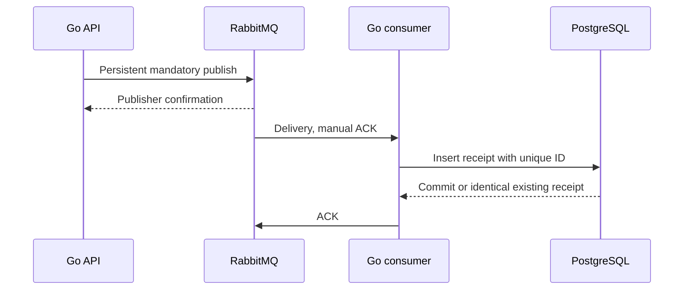

# Delivery contract

## Publication

The caller supplies a stable message ID, type, binary payload and optional correlation and causation IDs. The queue must belong to `QUEUES`. Validation runs before contacting RabbitMQ.

The publisher opens a channel, enables publisher confirmations and publishes a persistent message to the default exchange with `mandatory=true`. The queue name is the routing key. An absent queue produces `basic.return`, which is a failure even if a confirmation follows. The API replies successfully only after broker confirmation without a return.

Each in-flight publication has its own channel. `PUBLISH_CONCURRENCY` bounds their number; waiting callers retain their request deadlines. This favors readability over high-throughput channel pooling.

After a timeout or network failure, acceptance can be unknown. Retry with the **same ID and identical envelope**. The API does not deduplicate publication; the consumer deduplicates its durable effect.

| Result | gRPC status | Caller action |
| --- | --- | --- |
| Invalid envelope or unconfigured queue | `InvalidArgument` | Correct the request |
| Explicit broker rejection | `ResourceExhausted` | Retry with backoff after capacity recovers |
| Broker unavailable or unroutable message | `Unavailable` | Retry the identical message after recovery |
| Confirmation timeout | `DeadlineExceeded` | Retry identically; acceptance may already have happened |
| Request canceled | `Canceled` | Preserve the ID; acceptance may already have happened |

## Processing and duplicate suppression

Each worker owns a separate channel and prefetches one delivery. `CONCURRENCY=4` permits at most four unacknowledged deliveries per consumer process. Replicas share the queue and receipt database.

1. Receive and validate the envelope.
2. Insert a receipt with `(queue_name, message_id)` as the primary key.
3. If a receipt exists, compare the envelope fingerprint. Identical content is duplicate success; different content is an identity conflict.
4. Send ACK after a successful insert or an identical existing receipt.

The insert is itself the reference handler's effect. PostgreSQL's unique constraint arbitrates concurrent inserts across processes. The fingerprint covers type, payload, correlation ID and causation ID with explicit field boundaries.

If the process dies after commit and before ACK, RabbitMQ requeues when it detects the lost connection. A replacement finds the receipt and acknowledges without inserting again. Detection is not instantaneous; the connection requests ten-second heartbeats.

For real business logic, deduplication and database effects must commit in the **same transaction**. Checking a receipt, calling an external API and then inserting a receipt leaves a failure gap. External effects need an idempotency contract or an outbox. This is not a universal exactly-once processing mechanism.

Receipts are retained indefinitely. Deleting them while messages remain replayable would remove duplicate protection.

## Retries and dead letters

`MAX_RETRIES` is the number of additional processing opportunities after the initial delivery, default three. The worker reads `x-delivery-count`, waits `RETRY_DELAY` while holding its unacknowledged slot, then sends `basic.reject` with requeue enabled. RabbitMQ retains the original message; there is no publish-copy/ack-original handoff.

The quorum queue has a delivery limit. Connection loss also counts as a failed delivery, so crashes consume the budget. On RabbitMQ 4.3+, requeued `basic.nack` does not increment the failure counter; retry deliberately uses `basic.reject`.

Invalid envelopes, conflicting IDs and exhausted retries produce NACK without requeue. The broker transfers the message to `<queue>.dead`. The reserved type `lab.fail` always fails to demonstrate this path. Other types are recorded without interpreting the payload.

The source queue uses at-least-once dead-letter transfer and `reject-publish` overflow. RabbitMQ retains a dead letter until the destination confirms it. The durable dead-letter queue has no delivery limit, so repeated manual peeks do not discard messages. It has no automatic replay consumer or retention task.

Retry delay is fixed and occupies worker capacity. There is no delayed retry exchange or global ordering guarantee. A prolonged PostgreSQL outage can exhaust retries and send messages to the DLQ; database recovery does not automatically replay them.

## Failure boundaries

| Failure | Behavior |
| --- | --- |
| API dies before replying | Caller retries identically; the original publish may exist |
| Consumer dies before commit | Delivery is requeued for another attempt |
| Consumer dies after commit, before ACK | Redelivery finds the existing receipt |
| Broker connection is lost | API or consumer exits; Docker restarts it with fresh connections |
| Broker restarts with its volume | Durable queues and confirmed messages survive recovery |
| Broker volume is deleted | Queue data is lost |
| Source queue fills | New publications are rejected; in-flight writes can slightly overshoot the limit |
| DLQ target is unavailable | Source retains dead letters until transfer succeeds |

One RabbitMQ node protects against process restart with retained storage, not host or disk loss. Replication across nodes is a later experiment.

## References

- [Publisher confirmations and consumer acknowledgments](https://www.rabbitmq.com/docs/confirms)
- [Quorum queue dead-lettering and delivery limits](https://www.rabbitmq.com/docs/quorum-queues)
- [Go AMQP client recovery responsibilities](https://github.com/rabbitmq/amqp091-go)
